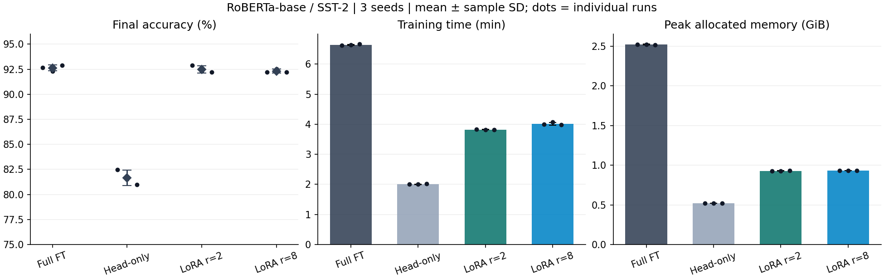

# Resource-Constrained LoRA Reproduction

CMP4509 — Introduction to Deep Learning, Bahçeşehir University.

Can a custom PyTorch implementation of LoRA approach full fine-tuning accuracy on SST-2 with substantially fewer trainable parameters? We compare Full FT, head-only FT, and Query/Value LoRA with ranks 2 and 8 on RoBERTa-base.

**Status:** Original Stage 5 experiments are complete. This is a public-workflow candidate: offline evidence auditing and static checks pass; the repackaged GPU workflow has not yet been executed. The report and presentation are not yet complete.

Repository: https://github.com/ykarakoca/CMP4509-LoRA-Reproduction

[Open in Colab](https://colab.research.google.com/github/ykarakoca/CMP4509-LoRA-Reproduction/blob/main/notebooks/reproduce.ipynb)

## Frozen results

| Method | Accuracy (%) ± sample SD | Trainable parameters | Training min ± SD | Peak allocated GiB ± SD |
|---|---:|---:|---:|---:|
| Full FT | 92.6223 ± 0.2886 | 124,647,170 | 6.6422 ± 0.0195 | 2.5209 ± 0.0055 |
| Head-only | 81.6514 ± 0.7520 | 592,130 | 2.0055 ± 0.0080 | 0.5209 ± 0.0000 |
| LoRA r=2 | 92.4694 ± 0.3686 | 665,858 | 3.8222 ± 0.0093 | 0.9288 ± 0.0009 |
| LoRA r=8 | 92.3165 ± 0.1986 | 887,042 | 4.0162 ± 0.0446 | 0.9327 ± 0.0009 |

Three seeds: 17, 42, 123; sample SD uses ddof=1. LoRA counts include adapters and the 592,130-parameter classifier. r=2 has 99.4658% fewer trainable parameters than Full FT, at a mean accuracy difference of −0.1529 percentage points. This is descriptive closeness, not statistical equivalence.



Training time sums all five synchronized training epochs; it excludes evaluation, model setup and checkpoint writes. Memory is the training peak of the PyTorch allocator, not total physical VRAM. These measurements apply to the original Tesla T4/FP32 environment.

## 1. Quick evidence audit — CPU, no model download

From the repository root:

```bash
python -m pip install numpy matplotlib
python scripts/analyze.py --output ../lora-frozen-audit
```

Checks public file hashes, 12 prediction hashes, ID/label consistency, logits/argmax, confusion matrices, accuracy, stable cross-entropy, checkpoint selection and mean/sample SD. Regenerates CSV/JSON and figures. It does not restore trained weights or independently retrieve dataset labels. Original sentence text and checkpoint weights are not bundled.

## 2. Full reproduction — free GPU

1. Open the Colab link above in a fresh GPU session. The first cell clones this public repository if absent. On Kaggle, enable Internet and GPU.
2. Alternatively, upload/import `notebooks/reproduce.ipynb` into Colab or Kaggle.
3. Set `REPO` in the first code cell to the extracted directory. The default is `/content/CMP4509-LoRA-Reproduction`.
4. Run all cells in order. The default is `MODE='full'`. Installation uses recorded non-Torch package versions and retains the platform's working CUDA/PyTorch installation. If a recorded pin cannot be installed, stop and report that failure; substitutions must be documented and tested.
5. The workflow downloads the pinned pretrained model and SST-2, reconstructs the original ordered splits using IDs, verifies content hashes, trains 12 fresh models, fixes every selected checkpoint, evaluates the 872-example final split, and writes new analysis and figures.
6. Download/save the entire output folder before the runtime expires. No access to the original team's private storage is needed.

CLI equivalent, from a GPU environment with PyTorch installed:

```bash
python -m pip install -r requirements.txt
python scripts/reproduce.py --mode full --output ../lora-public-full
```

Every training run uses a separate subprocess. Completed runs are skipped only after checkpoint/source/protocol checks. Failed or interrupted run records deliberately stop automatic continuation: inspect and move the failed run directory to an archive outside the active output directory, then rerun. Following an abrupt process kill, remove only the corresponding stale `.lock` after verifying no process is running. Never delete valid completed runs. The output path must be outside the repository.

Checkpoints support model restoration, not exact optimizer/scheduler/RNG resume. When returning in a new session, restore the entire output folder at the same absolute path before continuing. Full-FT checkpoints require roughly 0.5 GB each; allow several GB for weights, caches and outputs.

**Compute estimate:** Original training loops totaled approximately 49.46 minutes across 12 runs; recorded run wall times totaled about 53.81 minutes. Downloads, dependency setup, data preparation and final evaluation add time. These are historical measurements, not a promise about free GPU availability or runtime. Hyperparameter search is not repeated by this workflow; selected learning rates are frozen.

### Optional engineering smoke test

```bash
python scripts/reproduce.py --mode smoke --output ../lora-public-smoke
```

Runs all four methods at seed 42, one epoch, 64 training and 32 tuning examples. Two optimizer steps include an actual nonzero-LR update. It checks training and checkpoint restoration and never evaluates final data. It cannot replace the full reproduction.

### Environment policy

Original recorded environment: Python 3.13.16, torch 2.14.1+cu130, transformers 5.22.1, datasets 4.8.5, scikit-learn 1.6.1, Tesla T4, FP32. These values are taken from experiment evidence, not independently certified package availability. `requirements.txt` is a candidate installation specification pending a fresh Colab test.

Default portable mode records actual packages and GPU and permits differences from the original environment. Add `--strict-env` (or set `STRICT_ENV=True` in the notebook) to require the four recorded package versions and Tesla T4. Even strict mode is not a bitwise determinism guarantee. New results are independent repetitions stored separately from `results/`.

## Locked experimental protocol

- `FacebookAI/roberta-base`, revision `e2da8e2f811d1448a5b465c236feacd80ffbac7b`.
- GLUE SST-2: 10,000 training, 1,000 tuning; official validation used as 872-example final held-out evaluation. This is not the hidden-label GLUE test set.
- Original cleaning normalized case/whitespace, removed contradictory-label normalized texts and duplicates, then sampled stratified subsets with seed 2026. This workflow restores the verified IDs instead of drawing a fresh split; hashes verify original raw text, labels and order.
- Five epochs, microbatch 16, accumulation 2, dynamic padding, maximum length 128, FP32. Final accumulation group normalized by actual sample count.
- AdamW: weight decay .01, betas (.9,.999), epsilon 1e-8; one group for all trainable parameters. No gradient clipping. Linear warmup/decay, 94 warmup steps, 1,565 total steps (initial LR is zero).
- Full FT LR 2e-5; other methods 5e-4. Selected using two LR candidates per method at seed 42, before final evaluation. Tuning seed 42 overlaps the official seed set; official models were freshly initialized.
- LoRA: alpha 8, rank 2 or 8, Query and Value in all 12 layers (24 projections); classifier also trained. Frozen backbone remains in memory and dropout remains enabled during training, including head-only.
- Maximum tuning accuracy selects the checkpoint, then minimum tuning loss, then earliest epoch. All five epochs run. All 12 checkpoints are fixed before final evaluation.

## Implementation and provenance

`src/lora_linear.py`, `src/lora_injection.py`, `src/stage5_runtime.py` and `src/stage5_official_runtime.py` are byte-identical to the Stage 5 package. The official runtime supplies the numerical functions; the development runtime is retained for the original provenance dependency. They require the worker's globals and are not standalone scripts.

`src/train_worker.py` and `src/evaluate_runs.py` adapt the original entrypoints for configurable output roots, repository-relative sources, new-run indexes, and explicit environment policy. `scripts/reproduce.py` orchestrates them. See `docs/PACKAGING_CHANGES.md` and `docs/provenance.json`.

`results/frozen/` contains public derivatives of metadata with private paths removed, and byte-preserved predictions. `results/original_analysis/` contains original tables and figures. Their recorded source hashes still describe the original evidence; `PUBLIC_SHA256SUMS.json` checks the public files. Do not edit frozen measurements to match a later repetition.

To regenerate analysis for a new full run:

```bash
python scripts/analyze.py --runs ../lora-public-full --output ../lora-public-full/analysis
```

## Interpretation and limitations

Under our restricted protocol, custom LoRA approached Full FT accuracy with substantially fewer trainable parameters. Only three seeds, one task/model/hardware setup and a reduced training budget were studied. Similar means do not establish statistical equivalence. Holding alpha=8 changes alpha/r from 4 to 1 across the two ranks, so this is not an isolated causal test of rank.

Hu et al. Table 2 reports RoBERTa-base SST-2 Full FT 94.8 and LoRA 95.1 ± 0.2. Appendix D.1 reports the median across five seeds; our results are three-seed means ± sample SD. Training budgets and evaluation protocols differ, so we do not claim an exact reproduction of the published benchmark. Inference acceleration was not measured.

## Attribution and licensing

See `THIRD_PARTY_NOTICES.md`. No blanket license has been assigned to the team's own work without their choice. Dependency licenses do not automatically license this repository. No third-party package source, raw review text or model weights is redistributed.

- Hu et al., *LoRA: Low-Rank Adaptation of Large Language Models*, ICLR 2022: https://arxiv.org/abs/2106.09685
- Liu et al., *RoBERTa: A Robustly Optimized BERT Pretraining Approach*: https://arxiv.org/abs/1907.11692
- Socher et al., *Recursive Deep Models for Semantic Compositionality Over a Sentiment Treebank*: https://aclanthology.org/D13-1170/
- Wang et al., *GLUE: A Multi-Task Benchmark and Analysis Platform for Natural Language Understanding*: https://arxiv.org/abs/1804.07461

AI assistance supported planning, learning, code assistance, review, analysis and repository packaging. Original GPU experiments were executed by the student; the assistant's public-packaging checks were static and CPU evidence checks. Actual team contributions will be documented in the final report.
